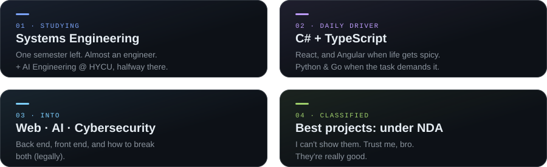
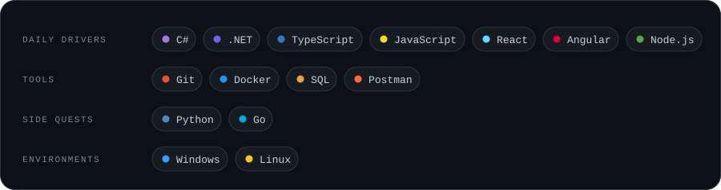

<div align="center">



<br><br>



<br><br>



<br><br>


</div>

<br>

```ts
const miguel = {
  from: "Perú 🇵🇪",
  fuel: "coffee ☕",
  bugsFixed: "∞",
  bugsCreated: "∞ + 1",
  worksOn: "my machine 🤷",
  osWars: "neutral, I use both 🪟🐧",
};
```

<br>

<div align="center">

<a href="https://www.linkedin.com/in/miguel-angel-espinoza-ricra-982b20271" target="_blank"></a>
<a href="https://www.instagram.com/moga_104/" target="_blank"></a>

<a href="mailto:miguel.es.ri1302@gmail.com"></a>

<br><br>


<br>
<sub><i>Bongo Cat is committing on my behalf. Please don't ask about the code review.</i></sub>

</div>
